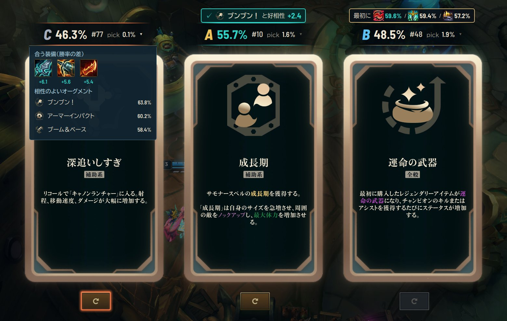

# Araug

League of Legends の ARAM: メイヘムで、オーグメントの選択に tier と勝率を日本語で重ねて出すツールです。

## できること

- **オーグメントの札**: 各カードの上に tier・勝率・順位・ピック率。いちばん良い 1 枚と、リロールしたほうがよいカードに印（マエストロの 4 択にも対応）
- **ランキング**: そのレア度のオーグメントを tier・勝率の順に並べ、今のカードが何位かを示す
- **合う装備と相性**: カードの札に乗せると、合う装備と相性のよいオーグメント
- **チャンピオン選択**: ベンチと味方の tier・勝率、いちばん上がる交換先、サモナースペルの組
- **試合中**: 型ごとのビルド・スキルの上げ方・敵のダメージの割合、次に上げるスキルの印、回復のタイマー
- **試合後**: 取ったオーグメントと勝敗の振り返り画像（X に投稿できる）

## 注意

次のことを自動で行います。どれも設定で切れます。

- マッチの承諾
- サモナースペルの設定
- 統計づくりへの協力（下の「送るもの」）

## 動かす条件

Windows 10 / 11（64 ビット）、LoL のクライアントが日本語、ゲームのウィンドウモードが「外枠無しモード」か「ウィンドウ」

## 入れ方

[Releases](https://github.com/eteKoutaishi/araug/releases/latest) から `Araug-Setup-<版>.exe` を取って開き、画面に沿って進めてください。

署名が無いため、Windows の警告が出ることがあります。「PC が保護されました」→「詳細情報」→「実行」で進めます。ウイルス対策ソフトが誤って検知することもあります。

新しい版が出ると、Araug の画面に「更新する」が出ます。消すときは Windows の「アプリと機能」から。

## 送るもの（統計づくりへの協力）

自分のメイヘムの試合と、同卓した人の直近のメイヘムの試合を、統計にするために送ります。

- 送る: チャンピオン・スペル・勝敗・キル・ダメージ・装備などの数値、サーバー・版・試合時間・日付、自分の 3 択と選んだカード
- 送らない: 名前・タグ・プレイヤーの ID、画面の画像、時刻（日付だけ）
- 設定で切れます。切ると、送っていない記録も消します

## うまく動かないとき

- **札が出ない**: クライアントが日本語か、ゲームのウィンドウモードが「外枠無しモード」か「ウィンドウ」かを確かめてください（合っていないと Araug の画面に案内が出ます）

---

Araug was created under Riot Games' "Legal Jibber Jabber" policy using assets owned by Riot Games. Riot Games does not endorse or sponsor this project.
